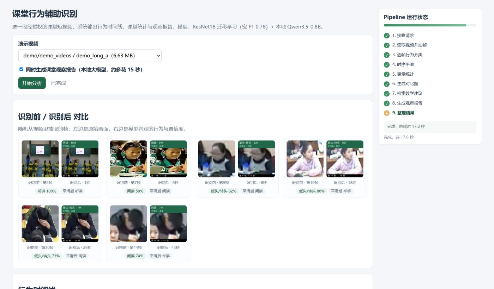

# 课堂行为辅助识别

> 输入一段**经授权**的课堂短视频，输出**行为时间线 + 课堂统计 + 自然语言观察报告**。

<p align="center">
  
</p>

## 这个项目解决什么

课堂录像通常只用于事后回看，教师很难从中快速了解"这节课学生普遍在做什么"。
本项目把视频变成结构化信息：先逐帧识别 5 类外显行为，再聚合成时间线与统计指标，
最后结合教学建议知识库，用本地小模型生成一份可直接阅读的观察报告。

> 说明：系统只反映**外显动作**，不能判断学生是否在思考。输出定位为辅助观察，不作为评价依据。

## 系统流程

```
视频/图片 → 抽帧 → 单人区域 → 行为分类(6类) → 时序平滑 → 时间线 + 课堂统计
                                                          ↓
                        教学建议知识库(FAISS 检索) → Prompt → 本地 Qwen → 观察报告
                                                          ↓
                各阶段经 /progress 上报 → 网页右侧实时显示 Pipeline 状态
```

行为类别：`listening` 听讲、`raising_hand` 举手、`reading` 阅读、`writing` 低头写字、`desk` 趴桌/睡觉。

> 第 6 类 `phone`（使用手机）已在标签映射中预留，真实数据补齐后加入 `CLASSES` 即可，模型会自动转为 6 分类。

## 效果

同一测试集（12,841 张，按拍摄场景分组划分，无跨场景泄漏）：

| 方案 | 测试准确率 | 宏 F1 |
| --- | --- | --- |
| HOG + SVM 基线 | 0.4416 | 0.4881 |
| ResNet18 冻结主干（只训分类头） | 0.4810 | 0.5795 |
| ResNet18 从头训练（不用预训练） | 0.6274 | 0.7082 |
| **ResNet18 预训练 + 全网络微调** | **0.7142** | **0.7812** |

四组对照的结论很直接：

- 只训分类头收益有限（冻结主干丢掉了预训练特征的表达能力）
- **不用预训练也能到 0.63**，预训练的真正价值在 0.63 → 0.71 这一段
- 数据划分按**拍摄场景**分组而非随机划分，否则同一场景的帧会同时进训练集和测试集，指标虚高

## 快速开始

```bash
# 1. 安装依赖（脚本已默认走国内镜像）
bash install.sh

# 2. 一键跑全流程：抽帧 → 划分 → 体检 → 基线 → 训练 → 建索引 → 对比 → 消融
bash run_all.sh

# 3. 起演示服务
python web/app.py          # http://127.0.0.1:8002
```

Windows 下直接双击 `启动演示.bat`（自动起服务并打开浏览器）。

### 网页怎么用

1. 下拉框选视频；
2. 勾选"同时生成观察报告"→ 点**开始分析**；
3. 右侧「Pipeline 状态」实时显示 9 个阶段（抽帧 → 逐帧分类 → 时序平滑 → 课堂统计 →
   生成对比图 → 检索教学建议 → 生成报告 → 整理结果），并给出"分类 64/90 帧"这类细粒度进度；
4. 结果区依次是：识别前/后对比（随机抽 6 帧）→ 行为时间线 → 课堂统计 → 观察报告 → 引用的教学建议。

### 接口

| 路径 | 作用 |
| --- | --- |
| `/examples` | 可选视频列表 |
| `/model-info` | 当前模型与指标 |
| `/progress` | Pipeline 进度（前端轮询） |
| `/analyze` | 分析主接口 |
| `/docs` | 自动生成的接口文档 |

## 目录结构

```
.
├─ src/           核心代码
│  ├─ prepare_frames.py    抽帧 + 按文件夹名自动标注
│  ├─ make_splits.py       按来源分层划分，防数据泄漏
│  ├─ check_dataset.py     数据集体检（分布/泄漏/重复帧/分辨率）
│  ├─ dataset.py           数据集与图像增强
│  ├─ baseline_hog_svm.py  HOG + SVM 基线
│  ├─ train_cnn.py         ResNet18（可 --no-freeze 微调 / --backbone scratch 对照）
│  ├─ evaluate.py          指标与混淆矩阵
│  ├─ analyze_video.py     视频 → 时间线 + 统计（含时序平滑）
│  ├─ build_index.py       教学建议 → 向量 → FAISS 索引
│  ├─ report_llm.py        统计 + 检索 → Prompt → Qwen → 报告
│  ├─ ablation.py          三组消融 + 报告数字忠实度检查
│  └─ compare_models.py    模型对比表与柱状图
├─ web/           演示服务（FastAPI + 单页前端）
├─ kb/            教学建议知识库（24 条）+ FAISS 索引
├─ tools/         演示与造数脚本（权重下载、合成数据、拼演示视频）
│                 不属于主链路，阅读时可跳过
├─ tests/         环境自检 / 脚本自查
├─ docs/          系统设计说明、训练说明
├─ 截图/          运行界面截图
├─ config.py      路径与超参数集中配置
├─ install.sh     一键安装
└─ run_all.sh     一键跑全流程
```

## 关于模型与数据

仓库**不包含**训练好的权重（4 份，共 170 MB）与数据集，原因见下：

- **数据集**：使用 SCB-Dataset 的 5 类共 64,568 张图像（listening 2451 / raising_hand 13388 /
  reading 23737 / writing 9694 / desk 15298），按拍摄场景分组划分
  训练 40,043 / 验证 11,684 / 测试 12,841。原始数据集请从其官方渠道获取。
- **权重**：按 `docs/训练说明.md` 复现，CPU 上跑完全流程约需数小时。
- **字体**：`assets/fonts/simhei.ttf`（9 MB）因体积未入仓，可换用系统自带黑体。

## 关于

三人团队项目。本人负责：**数据管线**（抽帧、按来源分层划分、数据集体检）、
**模型训练与对照实验**（HOG+SVM → 冻结主干 → 从头训练 → 预训练微调四组）、
**推理服务**（FastAPI 接口与 /progress 进度上报）、**报告生成链路**（FAISS 检索 + 本地小模型 + 数字校验）；
界面设计与文档由另外两位成员协作完成。

## 已知限制

| 限制 | 可能的改进 |
| --- | --- |
| 单人画面假设：多人场景按最大框裁剪，遮挡时误判 | 引入检测 + 跟踪，按 ID 稳定裁剪 |
| 分类模型只看单帧，快速动作（举手→放下）易漏 | 引入短时序模型（如 3D-CNN / 帧差） |
| 时序平滑窗口固定 5 帧，不同节奏的课堂不适配 | 按事件密度自适应窗口 |
| 报告由 0.8B 小模型生成，长文本易跑偏 | 换更大模型，或模板约束 + 数字校验 |
| 6 类中的 `phone` 缺真实数据 | 自采 3–5 分钟视频补齐 |
| 换教室/机位后准确率下降 | 采集少量新场景样本做微调 |

## License

MIT（代码）。第三方模型与数据集遵循其各自许可。

## 开发记录

| 日期 | 改动 |
| --- | --- |
| 2026-11-10 | 仓库整理：移除硬编码路径、与代码对齐类别说明、补 LICENSE 与架构文档、补充已知限制 |
